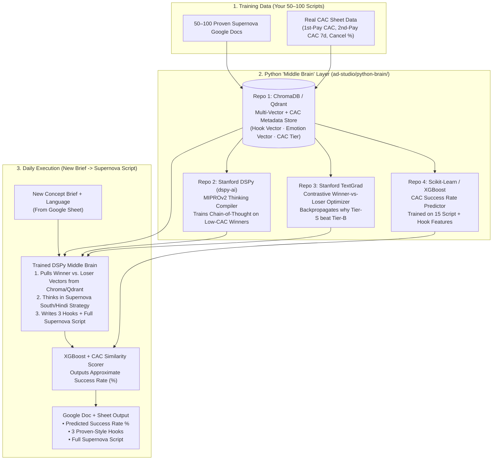

# Supernova "Middle Brain" Architecture (Python Training & Thinking Layer)

## 1. Overview: Why a Dedicated Python "Middle Brain" Layer?

A normal prompt tool (like a basic Claude/ChatGPT setup) only pastes Supernova rules onto a general script. To build a **true Supernova Middle Brain** that learns from your **50–100 proven scripts + real CAC numbers**, we use a **Python AI Training & Reasoning Layer** built on 4 proven open-source repositories.



---

## 2. The 4 Python Repositories Powering the Middle Brain

| # | Python Repository | GitHub / pip Package | Exact Role in the Supernova Middle Brain |
| :--- | :--- | :--- | :--- |
| **1** | **Stanford DSPy** | [`stanfordnlp/dspy`](https://github.com/stanfordnlp/dspy) (`pip install dspy`) | **The Core Thinking Compiler.** Defines `SupernovaMiddleBrain(dspy.Module)` using `dspy.ChainOfThought`. Takes your 50–100 `(Brief → Script + CAC Score)` rows and runs the **`MIPROv2` optimizer** so the model learns how to convert a short brief into a low-CAC Supernova script. |
| **2** | **ChromaDB / Qdrant** | [`chroma-core/chroma`](https://github.com/chroma-core/chroma) / [`qdrant/qdrant`](https://github.com/qdrant/qdrant) (`pip install chromadb` / `qdrant-client`) | **The Vector + Metadata Memory.** Stores 3 separate embeddings per script (**Hook Vector**, **Scenario/Pain-Point Vector**, and **Full Script Vector**) alongside structured CAC metrics (`cac_1st_pay`, `cac_2nd_pay_7d`, `cancel_pct`, `language`, `tier`). |
| **3** | **Stanford TextGrad** | [`zou-group/textgrad`](https://github.com/zou-group/textgrad) (`pip install textgrad`) | **"PyTorch for Text" (Winner vs. Loser Trainer).** Compares High-CAC (failed) scripts against Low-CAC (winning) scripts on the same topic, computes the "Textual Gradient" (*why the winner worked and why the loser failed*), and updates the Middle Brain's thinking rules automatically. |
| **4** | **Scikit-Learn + XGBoost** | [`scikit-learn/scikit-learn`](https://github.com/scikit-learn/scikit-learn) / [`dmlc/xgboost`](https://github.com/dmlc/xgboost) (`pip install scikit-learn xgboost`) | **The Approximate Success Rate Predictor.** Trains a statistical classifier on your 50–100 scripts' real CAC outcomes using 15 measurable features (hook word count, AI teacher entry turn, similarity to Tier-S winners vs. Tier-B losers, persona, language) to predict an honest **Success Rate (`0%–100%`)**. |

---

## 3. How the Python Layer Trains on Your 50–100 Scripts (`train_brain.py`)

When you provide the 50–100 Google Doc scripts + CAC sheet, the Python training pipeline runs **4 automated stages**:

### Stage 1: Multi-Vector & CAC Ingestion (`ChromaDB` / `Qdrant`)
For each of the 50–100 scripts, Python extracts:
- **CAC Label**: Computes whether the script beat its language average (`Tier S: >15% better CAC`, `Tier A: 0–15% better CAC`, `Tier B: Worse than average CAC`).
- **3 Vectors per Script** (using `gemini-embedding-001`):
  1. `hook_vector`: Embedding of the opening 2 lines + hook mechanic.
  2. `scenario_vector`: Embedding of the persona, setting, and English embarrassment moment.
  3. `script_vector`: Embedding of the full script flow.

### Stage 2: Contrastive Winner-vs-Loser Discovery (`TextGrad`)
- Python pairs every **Tier S Winner** with a **Tier B Underperformer** in the same language/persona.
- `TextGrad` runs a textual backpropagation pass asking:
  *"Both scripts are about a mother struggling with English in Tamil. Why did Script A get ₹420 CAC while Script B got ₹980 CAC?"*
- It distills the exact **Supernova Thinking Rules** (e.g., opening mid-mistake vs. slow introduction, sentence length, emotional reaction before pitching the app) and saves them into the Middle Brain.

### Stage 3: Compiling the Thinking Module (`DSPy MIPROv2`)
We define the DSPy module in Python:

```python
import dspy

class BriefToSupernovaScript(dspy.Signature):
    """Think like a top Supernova creative strategist. Use the matched Tier-S CAC winners
    to turn a short Concept Brief into a high-converting Supernova script."""
    concept_brief: str = dspy.InputField()
    language: str = dspy.InputField()
    ai_teacher_character: str = dspy.InputField()
    matched_cac_winners: str = dspy.InputField(desc="Top 3 low-CAC winning scripts + why they won")
    matched_cac_losers_to_avoid: str = dspy.InputField(desc="High-CAC patterns on this topic to avoid")

    supernova_thinking_plan: str = dspy.OutputField(desc="Exact hook mechanic, emotional trigger, and turn pacing plan")
    three_hook_options: list[str] = dspy.OutputField(desc="3 coupled Hook + Bridge (Line 1 + Line 2) openings")
    supernova_script: str = dspy.OutputField(desc="Complete Supernova formatted script with all mandatory USPs")

class SupernovaMiddleBrain(dspy.Module):
    def __init__(self):
        super().__init__()
        self.generate = dspy.ChainOfThought(BriefToSupernovaScript)

    def forward(self, concept_brief, language, ai_teacher_character, matched_cac_winners, matched_cac_losers_to_avoid):
        return self.generate(
            concept_brief=concept_brief,
            language=language,
            ai_teacher_character=ai_teacher_character,
            matched_cac_winners=matched_cac_winners,
            matched_cac_losers_to_avoid=matched_cac_losers_to_avoid,
        )
```

We then compile `SupernovaMiddleBrain` with `dspy.MIPROv2(metric=supernova_cac_and_compliance_metric)` over your 50–100 scripts, producing the trained artifact `compiled_supernova_brain.json`.

### Stage 4: Training the Success Rate Predictor (`XGBoost` + `Scikit-Learn`)
We train a calibrated classifier (`CalibratedClassifierCV(XGBClassifier())`) on your 50–100 scripts using:
1. Cosine similarity to **Tier S Winners** vs. **Tier B Losers** in `ChromaDB`.
2. Historical CAC win rate of the matched `(Language, Persona, Hook Angle)` cluster.
3. Structural features of the generated script (Hook word count, AI Teacher entry line, average words per turn, USP placement in first half, zero compliance violations).

---

## 4. How the Daily Pipeline Runs (Google Sheet $\rightarrow$ Python Middle Brain $\rightarrow$ Google Doc)

1. **Input in Google Sheet**: Writer enters `Concept Brief`, `Language`, and `Character`.
2. **Node.js calls Python Middle Brain (`ad-studio/python-brain/run_brain.py` / FastAPI microservice)**:
   - Queries `ChromaDB` for the **Top 3 Tier-S CAC Winners** and **1 Tier-B Loser to avoid** matching the brief's vector and language.
   - Runs the compiled **`DSPy SupernovaMiddleBrain`** (`ChainOfThought`) with Gemini to think through the strategy and write **3 Hook Options + the Full Supernova Script**.
   - Runs the **`XGBoost / Scikit-Learn Predictor`** to compute the **Approximate Success Rate %** (e.g., `81% — High Confidence`).
3. **Output**: Creates the formatted Google Doc and writes the **Doc Link + Success Rate %** back to the Google Sheet.
